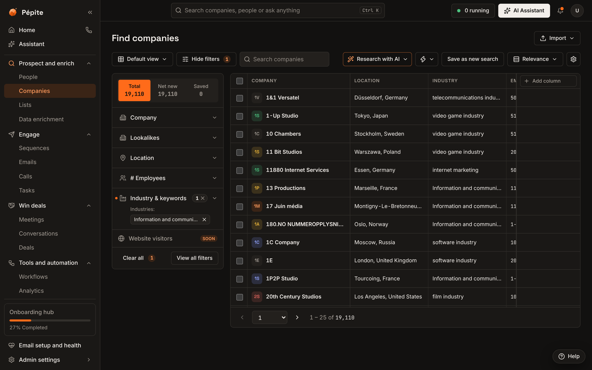
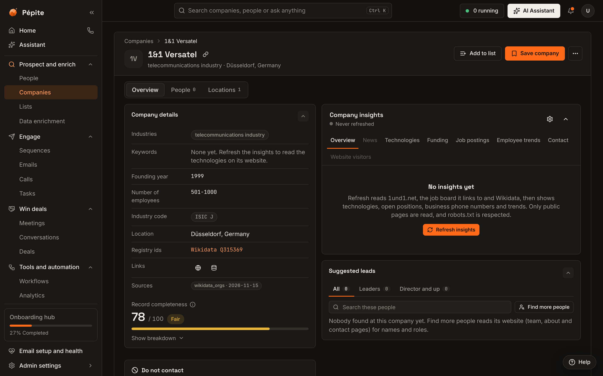
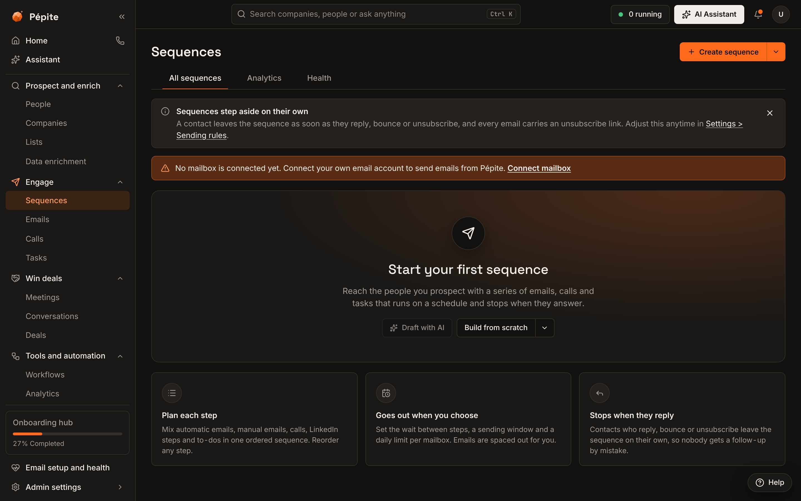

<p align="center">
  
</p>

<p align="center">
  <a href="https://github.com/aymaneprojects/leadcommons/releases/latest"></a>
  <a href="https://github.com/aymaneprojects/leadcommons/actions/workflows/ci.yml"></a>
  <a href="LICENSE"></a>
  
  
</p>

<p align="center">
  <a href="https://github.com/aymaneprojects/leadcommons/releases/latest"><b>Télécharger l'application</b></a> ·
  <a href="https://leadcommons.vercel.app"><b>Démo en ligne</b></a> ·
  <a href="docs/fr/getting-started.md">Premiers pas</a> ·
  <a href="docs/install.md">Guide d'installation</a> ·
  <a href="docs/data-sources.md">Sources de données</a>
</p>

<p align="center"><a href="README.md">English</a></p>

---

**Pépite** (une pépite, c'est un petit morceau d'or brut) trouve les entreprises auxquelles vous voulez vendre, les personnes qui les dirigent et leur adresse e-mail professionnelle probable, puis vous aide à les contacter. C'est une alternative gratuite et open source à des outils comme Apollo, pour celles et ceux qui ne peuvent pas payer un logiciel de vente : indépendants, étudiants, associations, jeunes fondateurs.

Il fonctionne sur **votre** ordinateur. Vos prospects ne le quittent jamais.

<p align="center">
  
</p>

## Pourquoi Pépite

- **Des données réelles, issues de registres officiels.** 21,8 millions d'entreprises actives dans 227 pays, reconstruites chaque mois à partir des registres publics (France, Royaume-Uni, Norvège, Australie, Canada…) et de jeux de données ouverts. Chaque fiche indique d'où vient chaque information.
- **À vous, pas à un éditeur.** Les personnes, les e-mails et les listes restent dans une base de données sur votre ordinateur. Rien n'est envoyé ni synchronisé.
- **Licite par conception.** Pas de scraping LinkedIn, pas de données achetées, pas de numéros de portable personnels, une page publique d'opposition et une liste de suppression vérifiée partout.
- **Tout le processus.** Recherche, recherche de personnes, vérification des e-mails, séquences d'e-mails, suivi des opportunités. Pas de crédits, pas de sièges, pas de limites.

## Ce que ça fait

| | |
| --- | --- |
| **Recherche d'entreprises** | Filtres par lieu, secteur, taille et mots-clés ; entreprises similaires, vues enregistrées et listes. |
| **Recherche par IA** | Décrivez ce que vous cherchez (« fintech française, 50 à 200 personnes ») et les filtres se remplissent. Fonctionne hors ligne ; peut utiliser votre propre modèle. |
| **Recherche de personnes** | Lit les pages publiques d'une entreprise et les registres officiels des dirigeants (Royaume-Uni, Norvège, dépôts SEC, Wikidata). |
| **Recherche d'e-mails** | Apprend le format d'adresse de chaque entreprise, puis vérifie le serveur MX, le fournisseur de messagerie et le comportement catch-all. Les scores sont calibrés sur une précision mesurée ([comment](docs/email-quality.md)). |
| **Séquences** | Campagnes d'e-mails en plusieurs étapes, envoyées depuis votre propre boîte mail, avec plages d'envoi, détection des réponses et lien de désinscription dans chaque e-mail. |
| **Opportunités et tâches** | Pipeline, rendez-vous, appels, tâches, automatisations et webhooks. |
| **Enrichissement de CSV** | Envoyez un CSV, récupérez-le avec les domaines, les personnes et les e-mails. |
| **Assistants IA** | Un serveur MCP intégré permet à Claude, ChatGPT et d'autres assistants de chercher des entreprises et de construire des listes pour vous. |

| Fiche entreprise | Séquences d'e-mails |
| --- | --- |
|  |  |

## Installation

**Application de bureau (le plus simple) :** téléchargez-la pour Windows, macOS (Apple Silicon) ou Linux depuis la [dernière version](https://github.com/aymaneprojects/leadcommons/releases/latest), puis ouvrez-la comme n'importe quelle autre application. Elle télécharge les entreprises de votre pays au premier démarrage. Voir [docs/desktop.md](docs/desktop.md).
Nouveau ici ? [Votre première heure avec Pépite](docs/fr/getting-started.md) vous mène de l'installation à votre première séquence d'e-mails.

**Installation en une ligne** (Linux, macOS) :

```sh
curl -fsSL https://raw.githubusercontent.com/aymaneprojects/leadcommons/main/scripts/install.sh | sh
```

Windows PowerShell :

```powershell
irm https://raw.githubusercontent.com/aymaneprojects/leadcommons/main/scripts/install.ps1 | iex
```

Elle télécharge aussi les entreprises de votre pays. Lancez ensuite `pepite serve` et ouvrez
<http://127.0.0.1:8000>.

<details>
<summary><b>Docker, votre propre serveur, depuis les sources, Vercel</b></summary>

**Docker**

```sh
git clone https://github.com/aymaneprojects/leadcommons.git pepite && cd pepite
docker compose up --build
```

Puis, dans un second terminal, téléchargez un pays (les données sont dans `./data`) :
`docker compose exec pepite pepite pack download --country FR`.

**Votre propre serveur**, avec Postgres, HTTPS automatique et une connexion : [docs/server.md](docs/server.md),
ou déploiement depuis GitHub Actions : [docs/deploy-with-actions.md](docs/deploy-with-actions.md).

**Depuis les sources**

```sh
git clone https://github.com/aymaneprojects/leadcommons.git pepite && cd pepite
uv sync --extra dev
uv run pepite serve
```

**Vercel** lance l'application en mode démo : la recherche d'entreprises fonctionne, mais la recherche de personnes et d'e-mails est désactivée, afin qu'une adresse publique ne serve jamais à explorer le web. Voir [docs/vercel.md](docs/vercel.md).

</details>

## Démarrage rapide

```sh
pepite pack download --country FR   # companies of a country (a small sample is bundled)
pepite serve                        # web app on http://127.0.0.1:8000
pepite find-people example.com      # people on a company's public pages
pepite find-email "Ada Lovelace" example.com
pepite enrich companies.csv enriched.csv
pepite optout someone@example.com   # never contact this address
```

Utilisez-le depuis Claude Code avec `claude mcp add pepite -- pepite mcp` ([plus d'informations](docs/mcp.md)).
Les paramètres sont listés dans [docs/install.md](docs/install.md) ; `pepite --help` affiche toutes les commandes.

## D'où viennent les données

| Source | Pays | Licence |
| --- | --- | --- |
| [INSEE SIRENE](https://www.sirene.fr) | France | Licence Ouverte 2.0 |
| [Companies House](https://www.gov.uk/government/organisations/companies-house) | Royaume-Uni | OGL 3.0 |
| [Brønnøysund Register Centre](https://www.brreg.no) | Norvège | NLOD 2.0 |
| [Australian Business Register](https://abr.gov.au) | Australie | CC BY 3.0 AU |
| [Corporations Canada](https://ised-isde.canada.ca/site/corporations-canada/en) | Canada | OGL Canada 2.0 |
| [GLEIF](https://www.gleif.org) | monde (entités juridiques) | CC0 |
| [Wikidata](https://www.wikidata.org) | monde | CC0 |
| [SEC EDGAR](https://www.sec.gov/edgar) | États-Unis (prochaine version) | domaine public |

Les packs sont publiés chaque mois sous forme de [versions GitHub](https://github.com/aymaneprojects/leadcommons/releases),
avec un rapport de qualité et un `ATTRIBUTION.md`. Ils ne contiennent que des entreprises : les personnes sont recherchées à la demande, sur votre ordinateur. À venir : les sites web des entreprises, reliés aux numéros d'immatriculation figurant sur leurs propres mentions légales ([docs/sitescan.md](docs/sitescan.md)), et d'autres pays ([feuille de route](docs/dev/data-roadmap.md)).

## Vie privée et éthique

- Exploration polie : robots.txt respecté, débit limité, un nom de robot qui renvoie vers sa documentation.
- Pas de collecte derrière une connexion, pas de contournement de paywall ni de captcha, pas de pixels de suivi.
- Une page publique d'opposition (`/opt-out`) et une liste de suppression hachée, respectées partout.
- Destiné à la prospection B2B. Vous restez responsable du droit qui vous est applicable (RGPD, ePrivacy, CAN-SPAM) et du respect des oppositions. Plus d'informations dans [docs/privacy.md](docs/privacy.md).

## Contribuer

Les signalements de bogues et les propositions de modifications (pull requests) sont les bienvenus : voir [CONTRIBUTING.md](CONTRIBUTING.md). Signalez les problèmes de sécurité comme décrit dans [SECURITY.md](SECURITY.md).

## Licence

[GNU AGPL v3 ou ultérieure](LICENSE). Si vous exploitez une version modifiée comme service en ligne, proposez son code source à ses utilisateurs.
