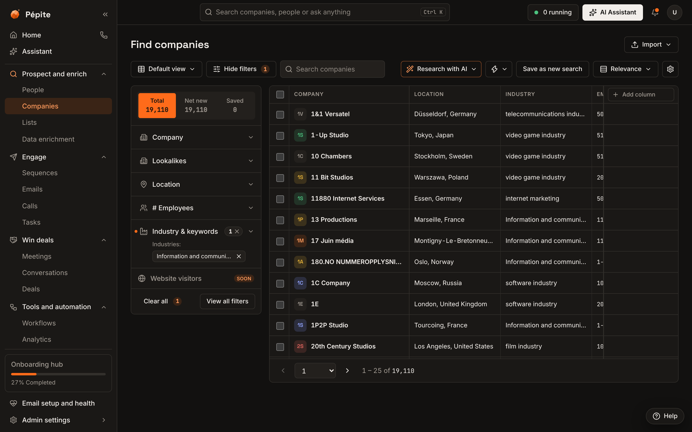
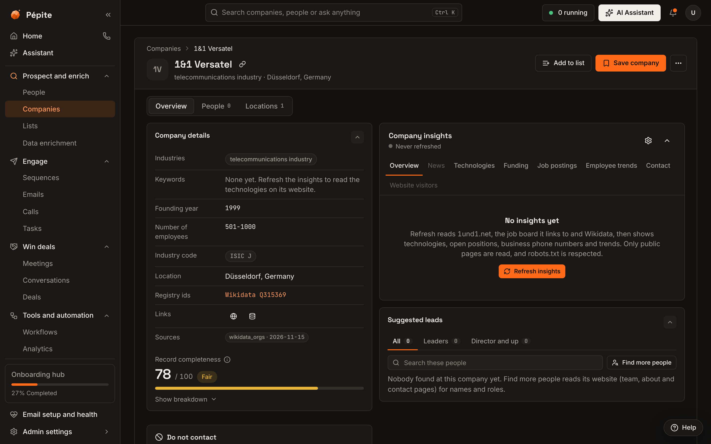
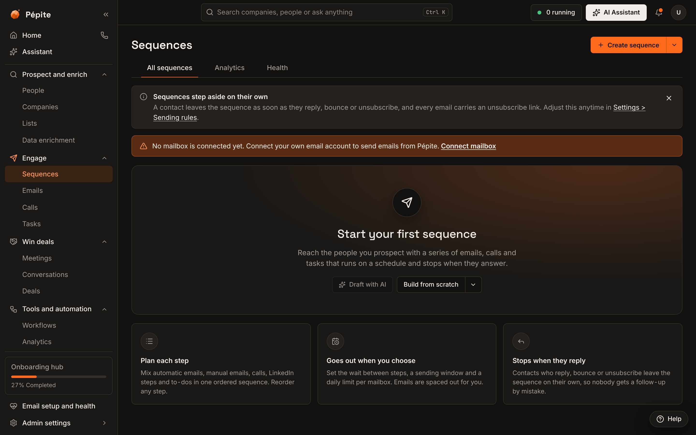

<p align="center">
  
</p>

<p align="center">
  <a href="https://github.com/aymaneprojects/leadcommons/releases/latest"></a>
  <a href="https://github.com/aymaneprojects/leadcommons/actions/workflows/ci.yml"></a>
  <a href="LICENSE"></a>
  
  
</p>

<p align="center">
  <a href="https://github.com/aymaneprojects/leadcommons/releases/latest"><b>Download the app</b></a> ·
  <a href="https://leadcommons.vercel.app"><b>Live demo</b></a> ·
  <a href="docs/getting-started.md">Getting started</a> ·
  <a href="docs/install.md">Install guide</a> ·
  <a href="docs/data-sources.md">Data sources</a>
</p>

---

**Pépite** (French for *nugget*) finds the companies you want to sell to, the people who run them
and their likely work email, then helps you contact them. It is a free, open-source alternative to
tools like Apollo, for people who cannot pay for sales software: freelancers, students,
associations, early founders.

It runs on **your** computer. Your leads never leave it.

<p align="center">
  
</p>

## Why Pépite

- **Real data, from official registers.** 21.8 million active companies in 227 countries, rebuilt
  every month from government registers (France, UK, Norway, Australia, Canada…) and open
  datasets. Every record shows where each fact comes from.
- **Yours, not a vendor's.** People, emails and lists stay in a database on your machine. Nothing
  is uploaded or synced.
- **Lawful by design.** No LinkedIn scraping, no bought data, no personal mobile numbers, a public
  opt-out page and a suppression list that is checked everywhere.
- **The whole workflow.** Search, find people, verify emails, run email sequences, track deals. No
  credits, no seats, no limits.

## What it does

| | |
| --- | --- |
| **Company search** | Filters for place, industry, size and keywords; lookalikes, saved views and lists. |
| **AI search** | Type who you want ("French fintech startups, 50-200 people") and the filters fill in. Works offline; can use your own model. |
| **People finder** | Reads a company's public pages and official officer registers (UK, Norway, SEC filings, Wikidata). |
| **Email finder** | Learns each company's address format, then checks MX, the mail provider and catch-all behaviour. Scores are calibrated against measured precision ([how](docs/email-quality.md)). |
| **Sequences** | Multi-step email campaigns sent from your own mailbox, with sending windows, reply detection and an unsubscribe link in every email. |
| **Deals and tasks** | Pipeline, meetings, calls, tasks, workflows and webhooks. |
| **CSV enrichment** | Upload a CSV, get it back with domains, people and emails. |
| **AI assistants** | A built-in MCP server lets Claude, ChatGPT and other assistants search and build lists for you. |

| Company profile | Email sequences |
| --- | --- |
|  |  |

## Install

**Desktop app (easiest):** download it for Windows, macOS (Apple Silicon) or Linux from the
[latest release](https://github.com/aymaneprojects/leadcommons/releases/latest) and open it like any
other app. It downloads your country's companies on first start. See [docs/desktop.md](docs/desktop.md).
New here? [Your first hour with Pépite](docs/getting-started.md) goes from install to your first
email sequence.

**One-line install** (Linux, macOS):

```sh
curl -fsSL https://raw.githubusercontent.com/aymaneprojects/leadcommons/main/scripts/install.sh | sh
```

Windows PowerShell:

```powershell
irm https://raw.githubusercontent.com/aymaneprojects/leadcommons/main/scripts/install.ps1 | iex
```

It also downloads the companies of your country. Then run `pepite serve` and open
<http://127.0.0.1:8000>.

<details>
<summary><b>Docker, your own server, from source, Vercel</b></summary>

**Docker**

```sh
git clone https://github.com/aymaneprojects/leadcommons.git pepite && cd pepite
docker compose up --build
```

Then, in a second terminal, download a country (data lives in `./data`):
`docker compose exec pepite pepite pack download --country FR`.

**Your own server** with Postgres, automatic HTTPS and a login: [docs/server.md](docs/server.md),
or deploy from GitHub Actions: [docs/deploy-with-actions.md](docs/deploy-with-actions.md).

**From source**

```sh
git clone https://github.com/aymaneprojects/leadcommons.git pepite && cd pepite
uv sync --extra dev
uv run pepite serve
```

**Vercel** runs the app in demo mode: company search works, finding people and emails is off, so
a public URL is never used to crawl. See [docs/vercel.md](docs/vercel.md).

</details>

## Quick start

```sh
pepite pack download --country FR   # companies of a country (a small sample is bundled)
pepite serve                        # web app on http://127.0.0.1:8000
pepite find-people example.com      # people on a company's public pages
pepite find-email "Ada Lovelace" example.com
pepite enrich companies.csv enriched.csv
pepite optout someone@example.com   # never contact this address
```

Use it from Claude Code with `claude mcp add pepite -- pepite mcp` ([more](docs/mcp.md)).
Settings are listed in [docs/install.md](docs/install.md); `pepite --help` lists every command.

## Where the data comes from

| Source | Countries | Licence |
| --- | --- | --- |
| [INSEE SIRENE](https://www.sirene.fr) | France | Licence Ouverte 2.0 |
| [Companies House](https://www.gov.uk/government/organisations/companies-house) | United Kingdom | OGL 3.0 |
| [Brønnøysund Register Centre](https://www.brreg.no) | Norway | NLOD 2.0 |
| [Australian Business Register](https://abr.gov.au) | Australia | CC BY 3.0 AU |
| [Corporations Canada](https://ised-isde.canada.ca/site/corporations-canada/en) | Canada | OGL Canada 2.0 |
| [GLEIF](https://www.gleif.org) | worldwide (legal entities) | CC0 |
| [Wikidata](https://www.wikidata.org) | worldwide | CC0 |
| [SEC EDGAR](https://www.sec.gov/edgar) | United States (next build) | public domain |

Packs are published monthly as [GitHub releases](https://github.com/aymaneprojects/leadcommons/releases)
with a quality report and an `ATTRIBUTION.md`. They hold companies only; people are found on
demand, on your machine. Next: company websites linked from the register numbers printed on their
own legal pages ([docs/sitescan.md](docs/sitescan.md)) and more countries
([roadmap](docs/dev/data-roadmap.md)).

## Privacy and ethics

- Polite crawling: robots.txt respected, rate-limited, a bot name that links to its documentation.
- No scraping behind logins, no paywall or captcha bypassing, no tracking pixels.
- A public `/opt-out` page and a hashed suppression list honoured everywhere.
- Meant for B2B outreach. You stay responsible for the law that applies to you (GDPR, ePrivacy,
  CAN-SPAM) and for honouring opt-outs. More in [docs/privacy.md](docs/privacy.md).

## Contributing

Issues and pull requests are welcome: see [CONTRIBUTING.md](CONTRIBUTING.md). Report security
problems as described in [SECURITY.md](SECURITY.md).

## Licence

[GNU AGPL v3 or later](LICENSE). If you run a modified version as a network service, offer its
source to its users.
