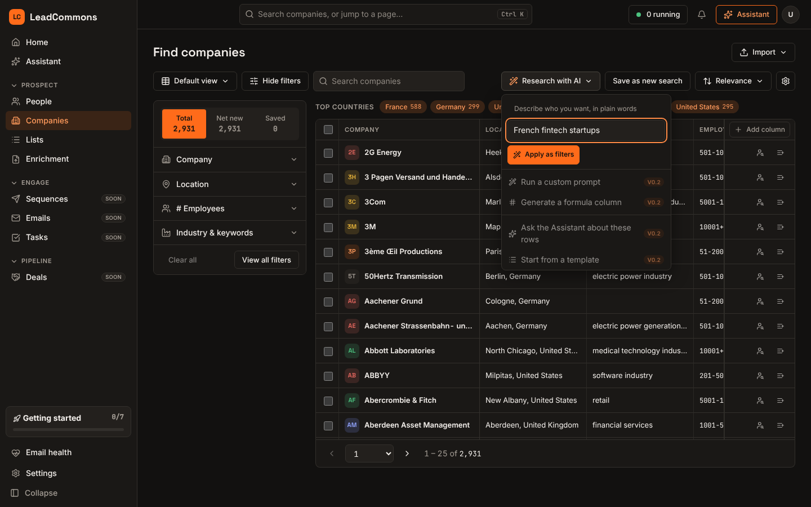

# LeadCommons

**Free, open-source, local-first prospecting.** LeadCommons helps you find companies, the people who work there, and their likely work email addresses, using only public, lawful data. It is an open-source alternative to tools like Apollo, built for people who cannot pay for sales tools: freelancers, students, small associations, early founders.

You run it on your own computer (or your own server). Your leads never leave your machine.

## What it does

- **Company search** over open data packs (Wikidata, GLEIF, and the French SIRENE registry): include/exclude filters for country, industry, size and keywords, column chooser, saved views.
- **AI search**: type who you want in plain words (English or French), e.g. "French fintech startups" or "CTOs at German SaaS companies, 50-200", and it fills the filters. Works offline with rules; can use a local model (Ollama) if you set `LEADCOMMONS_LLM_URL`.
- **People finder**: reads a company's public pages (team, about, legal notice, contact) and lists the people it finds with their job titles.
- **Email finder and checker**: infers the address pattern from public addresses, then checks syntax, MX records and catch-all behaviour. An optional live SMTP probe is off by default.
- **Lists and saved searches**, stored in a local database.
- **CSV enrichment**: upload a CSV, get one back with domains, contacts and emails.
- **Opt-out and suppression list**: a public `/opt-out` page and a list that is checked before anything is returned.
- **Command line** and **web interface**, in local (no login) or server (password) mode.

| Search | Company profile | AI search |
| --- | --- | --- |
|  |  |  |

## Install

Pick one. Details in [docs/install.md](docs/install.md).

### 1. One-line installer (Linux, macOS, Windows)

```sh
curl -fsSL https://raw.githubusercontent.com/aymaneprojects/leadcommons/main/scripts/install.sh | sh
```

Windows PowerShell:

```powershell
irm https://raw.githubusercontent.com/aymaneprojects/leadcommons/main/scripts/install.ps1 | iex
```

Then run `leadcommons serve` and open <http://127.0.0.1:8000>.

### 2. Docker

```sh
git clone https://github.com/aymaneprojects/leadcommons.git
cd leadcommons
docker compose up --build
```

Open <http://127.0.0.1:8000>. Your data is kept in `./data`.

### 3. Your own server (Docker Compose + Caddy + HTTPS)

Postgres, automatic HTTPS and a login, on any small VPS. Step by step in [docs/server.md](docs/server.md).

### 4. Deploy from GitHub Actions to your VPS

Fork the repository, add a few secrets, click "Run workflow". See [docs/deploy-with-actions.md](docs/deploy-with-actions.md).

### 5. From source

```sh
git clone https://github.com/aymaneprojects/leadcommons.git
cd leadcommons
uv sync --extra dev
uv run leadcommons serve
```

### Public demo on Vercel

The repository deploys to Vercel as is (`vercel_app.py`, `vercel.json`). On Vercel the app runs in
**demo mode**: anyone can search the company data, but finding people and emails is turned off, so
a public URL is never used to crawl websites or check addresses. Saved lists are temporary there
(serverless hosts have no permanent disk). For real use, install it locally or on your own server.
Details in [docs/vercel.md](docs/vercel.md).

## Quick start

```sh
leadcommons pack download latest        # real company data (a small sample is bundled)
leadcommons serve                       # web app on http://127.0.0.1:8000
leadcommons find-people example.com     # people on a company's public pages
leadcommons find-email "Ada Lovelace" example.com
leadcommons enrich companies.csv enriched.csv
leadcommons optout someone@example.com  # never contact this address
leadcommons --help
```

## Use it from Claude or ChatGPT

LeadCommons includes an MCP server, so an AI assistant can search companies, find people and emails, build lists and export CSV for you.

```sh
claude mcp add leadcommons -- leadcommons mcp        # Claude Code
```

For Claude Desktop, add `{"command": "leadcommons", "args": ["mcp"]}` to `claude_desktop_config.json`. For ChatGPT and other remote clients, run `leadcommons mcp --http` behind your HTTPS server with a bearer token. Details and security notes: [docs/mcp.md](docs/mcp.md).

## Data sources and licences

| Source | Licence | Used for |
| --- | --- | --- |
| [Wikidata](https://www.wikidata.org) | CC0 | company names, websites, countries, industries |
| [GLEIF](https://www.gleif.org) | CC0 | legal entity records |
| OpenStreetMap (planned) | ODbL | local businesses; needs attribution and share-alike |

Company packs are built monthly and published as GitHub Releases with an `ATTRIBUTION.md`. See [docs/data-sources.md](docs/data-sources.md).

## Privacy

- **Local-first.** People and emails are stored only in your own database (SQLite on your machine, or your own Postgres). Nothing is uploaded or synced.
- **Company data is shared, personal data is not.** Packs contain companies only.
- **Public `/opt-out` page** and a **suppression list** (stored as hashes) let anyone ask not to be contacted.

More in [docs/privacy.md](docs/privacy.md).

## Ethics

- No scraping behind logins, no bypassing paywalls or captchas.
- Polite crawling: robots.txt is respected, requests are rate-limited, and the crawler identifies itself.
- Meant for B2B outreach to professional contacts. You are responsible for following the law that applies to you (GDPR, CAN-SPAM, ePrivacy...) and for honouring opt-outs.

## Roadmap

- **v0.2**: OpenStreetMap connector, better title and seniority detection, CSV export of lists, more countries' company registers.
- **v0.3**: shared community packs for people-free signals (technology, hiring), email sequences export, plug-in connector registry.

## Contributing

Issues and pull requests are welcome. See [CONTRIBUTING.md](CONTRIBUTING.md). Report security problems as described in [SECURITY.md](SECURITY.md).

## Licence

[GNU AGPL v3 or later](LICENSE). If you run a modified version as a network service, you must offer its source to its users.
